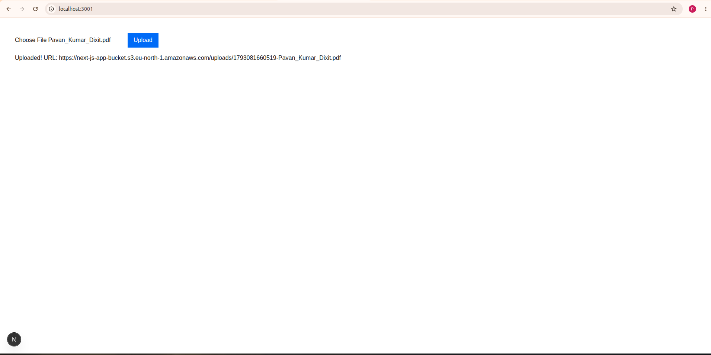
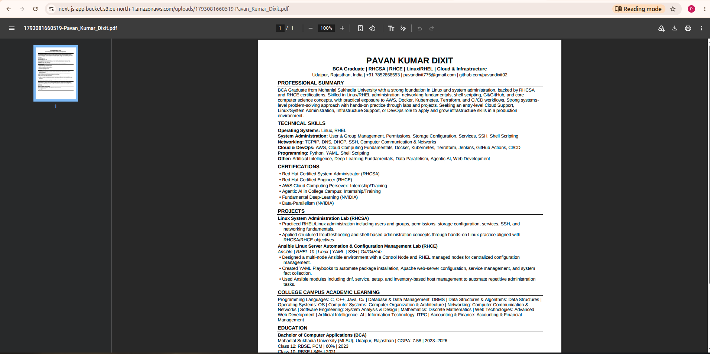
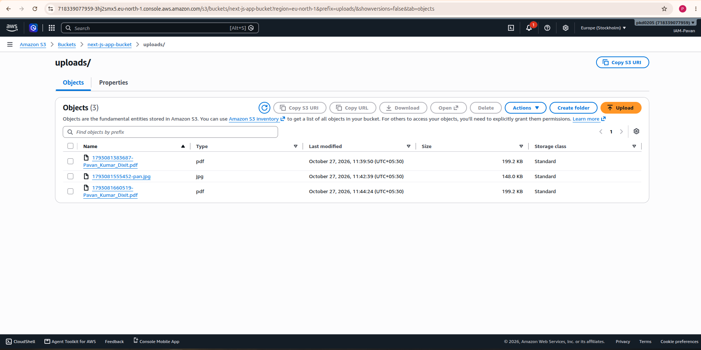

# Next.js File Upload to Amazon S3 ☁️

A full-stack web application that uploads files from a Next.js interface to **Amazon Simple Storage Service (Amazon S3)**. This project demonstrates how a frontend form can communicate with a server-side API route and store uploaded files in remote cloud object storage.

> **Security note:** Never expose AWS credentials in browser-side code or commit secrets to GitHub. Review `bucket_policy.txt` before using it; public bucket access should only be enabled when genuinely required.

---

## ✨ Features

- File selection through a Next.js user interface.
- Server-side upload endpoint using the Next.js App Router.
- Remote file storage in Amazon S3.
- AWS configuration handled by the backend.
- Screenshots documenting the upload interface and result.
- Bucket policy notes included for reference.

## 🧰 Technology Stack

| Technology | Purpose |
|---|---|
| Next.js | Full-stack web application |
| React | User interface |
| Node.js | Server-side runtime |
| TypeScript | Type-safe application code |
| Amazon S3 | Remote object storage |
| AWS SDK for JavaScript | S3 integration, if used by the implementation |
| npm | Dependency management |

## 🏗️ How It Works

```text
User selects a file
        |
        v
Next.js Frontend
(app/page.tsx)
        |
        | Upload request
        v
Next.js API Route
(app/api/upload/route.ts)
        |
        | AWS SDK / authorized upload
        v
Amazon S3 Bucket
        |
        v
API returns upload status
        |
        v
Frontend displays result
```

The frontend sends the selected file to the Next.js API route. The server-side route handles the upload to S3 and returns a result to the UI.

**Note:** This overview follows the repository structure. Confirm the exact request format, AWS SDK usage, environment variables, and response format in `app/api/upload/route.ts`.

---

## 📁 Repository Structure

```text
.
├── .gitignore
├── Output-Images/
│   ├── next-js-upload.png
│   ├── outpus-s3-upload-next-js.png
│   └── s3-upload-next-js.png
├── README.md
├── app/
│   ├── api/
│   │   └── upload/
│   │       └── route.ts
│   ├── favicon.ico
│   ├── globals.css
│   ├── layout.tsx
│   └── page.tsx
├── bucket_policy.txt
├── next.config.ts
├── package-lock.json
├── package.json
├── postcss.config.mjs
├── public/
│   ├── file.svg
│   ├── globe.svg
│   ├── next.svg
│   ├── vercel.svg
│   └── window.svg
└── tsconfig.json
```

### Key Files

| File | Description |
|---|---|
| `app/page.tsx` | Main page and file-upload interface |
| `app/api/upload/route.ts` | Server-side endpoint that processes uploads |
| `app/layout.tsx` | Root layout for the Next.js application |
| `app/globals.css` | Global styles |
| `bucket_policy.txt` | Reference notes or policy JSON for S3; review before applying |
| `package.json` | Project dependencies and scripts |
| `.gitignore` | Files and folders excluded from Git |
| `Output-Images/` | Screenshots of the application and upload results |

---

## 🖼️ Screenshots

### 1. File Upload Interface



### 2. S3 Upload Workflow



### 3. Upload Result



If a screenshot does not display on GitHub, verify the filename and capitalization match the repository exactly.

---

## ✅ Prerequisites

Before running this project, make sure you have:

- Node.js and npm installed.
- An AWS account with access to Amazon S3.
- An S3 bucket created in the intended AWS Region.
- An IAM identity with permission to upload objects to the target bucket.
- The project cloned to your local machine.

## 🚀 Getting Started

### 1. Clone the repository

```bash
git clone <YOUR_GITHUB_REPOSITORY_URL>
cd <YOUR_PROJECT_DIRECTORY>
```

Replace the placeholders with your actual repository URL and project directory.

### 2. Install dependencies

```bash
npm install
```

### 3. Configure AWS access securely

Use an IAM identity that has only the permissions needed for this project. For local development, you can configure the AWS CLI:

```bash
aws configure
```

Verify the active identity:

```bash
aws sts get-caller-identity
```

Do not use root-account access keys for application development. Never place credentials in `app/page.tsx`, expose them to the browser, or commit them to GitHub.

### 4. Configure environment variables

Inspect `app/api/upload/route.ts` to identify the exact environment variables used by the application. If the code expects them, create a `.env.local` file in the project root.

For example, your implementation might use:

```dotenv
AWS_REGION=your-aws-region
S3_BUCKET_NAME=your-bucket-name
```

These names are examples only. Use the names your code actually reads. Prefer the AWS SDK credential provider chain or an IAM role rather than hardcoding AWS access keys.

Make sure `.env.local` is listed in `.gitignore`.

### 5. Verify the S3 bucket

In the AWS Console:

1. Open **Amazon S3**.
2. Select the target bucket.
3. Confirm its name and Region.
4. Review the bucket's permissions and encryption settings.
5. Confirm that the backend IAM identity can upload objects to the intended bucket.

If the application uses a bucket policy, review `bucket_policy.txt` and confirm that it matches your bucket and security requirements before applying it.

---

## ▶️ Run the Application

Start the development server:

```bash
npm run dev
```

Open the local URL printed in the terminal. It is commonly:

```text
http://localhost:3000
```

If port 3000 is already in use, Next.js may choose a different port.

## 🧪 Test the Upload

1. Open the application in your browser.
2. Select a harmless sample file.
3. Submit the upload form.
4. Review the success or error message.
5. Open the target bucket in the AWS S3 Console.
6. Refresh the object list and verify that the file exists.

A success message in the frontend alone does not prove that the object was stored. Confirm the uploaded object in S3 and inspect server logs if the request fails.

---

## 🔐 Security Best Practices

- **Keep AWS credentials server-side.** Never include access keys in frontend components or public repositories.
- **Use least privilege.** Grant the backend only the required S3 permissions, scoped to the intended bucket or prefix where practical.
- **Keep Block Public Access enabled** unless public access is an explicit requirement.
- **Review `bucket_policy.txt` carefully.** A policy that grants public read or write access can expose data or allow abuse.
- **Validate uploads on the server.** Check file size, allowed file types, and request validity; do not rely only on browser-side checks.
- **Avoid trusting filenames.** Sanitize or generate object keys to reduce path confusion and overwrites.
- **Consider encryption and lifecycle rules** according to the application's data needs.
- **Never upload private keys, credentials, or confidential personal data** as public test objects.
- **Monitor AWS usage and billing.** Storage, requests, and data transfer may incur charges.

### About Public File Access

Uploading a file to S3 does not automatically make it public. If users need to download an object, prefer an authenticated backend or a short-lived presigned URL when suitable. Do not disable public-access protections just to make an upload work.

---

## 🛠️ Troubleshooting

### Upload returns an error

- Inspect the browser Developer Tools Network tab.
- Check the terminal running `npm run dev`.
- Verify the request format expected by `app/api/upload/route.ts`.
- Confirm that the file size and type are supported by the application.

### AWS AccessDenied error

- Verify the configured identity with `aws sts get-caller-identity`.
- Confirm the IAM permissions for the target bucket.
- Review bucket policies, organization restrictions, and any explicit deny statements.
- Check that the bucket name and Region are correct.

### The file does not appear in S3

- Confirm the upload API returned success.
- Verify the correct bucket and Region in the AWS Console.
- Inspect server-side logs for the S3 SDK error.
- Confirm that the API route awaits and handles the upload operation.

### Environment variables are not loaded

- Confirm the variable names match the code.
- Restart the development server after changing `.env.local`.
- Never prefix server-only AWS credentials with `NEXT_PUBLIC_`.

---

## 💡 What This Project Demonstrates

- Building a file upload interface with Next.js.
- Creating a server-side API route with TypeScript.
- Connecting a web application to Amazon S3.
- Understanding IAM permissions and remote object storage.
- Testing cloud uploads and documenting results with screenshots.
- Applying security practices to a cloud-connected application.

## 🔮 Future Improvements

- Display upload progress and file metadata.
- Add file size and MIME-type validation.
- Generate presigned URLs for secure direct uploads.
- Add authentication and per-user access control.
- Store upload metadata in a database if required.
- Add automated tests and deployment automation.
- Add monitoring and structured error logging.

## 👨‍💻 Author

**Pavan Kumar Dixit**

This project is part of my hands-on learning in **AWS Cloud Computing, Next.js, and DevOps**.
